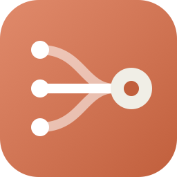
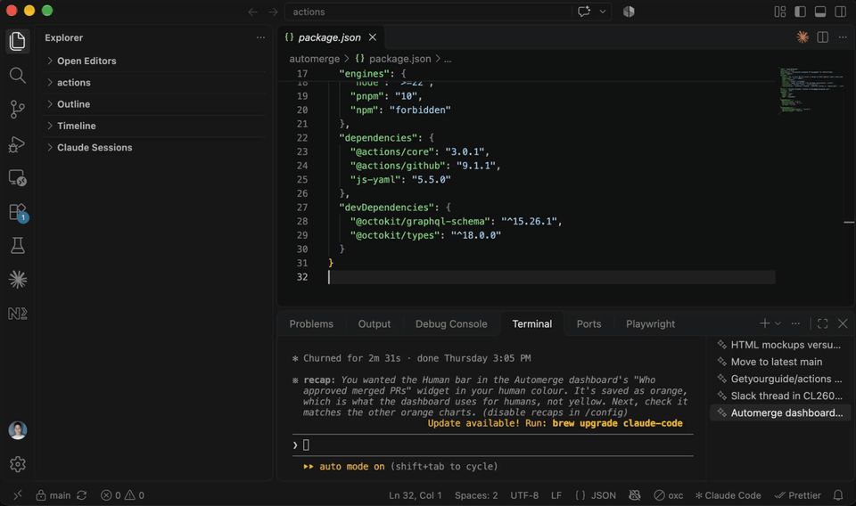

<p align="center"></p>

<h1 align="center">Multi-Repo Sessions for Claude Code</h1>

<p align="center"><b>Every Claude Code session, from every project, in one list.</b><br>One click takes you to its worktree and resumes it.</p>

<p align="center">
  <a href="https://github.com/fallemand/claude-multirepo-sessions/actions/workflows/ci.yml"></a>
  <a href="LICENSE"></a>
  <a href="https://open-vsx.org/extension/fallemand/claude-multirepo-sessions"></a>
  <!-- Uncomment once on the VS Marketplace (shields.io retired its badges):
  <a href="https://marketplace.visualstudio.com/items?itemName=fallemand.claude-multirepo-sessions"></a>
  <a href="https://marketplace.visualstudio.com/items?itemName=fallemand.claude-multirepo-sessions"></a>
  -->
</p>

<p align="center"></p>

## Why

The Claude Code extension only shows the sessions of the project you have open. Run a few in parallel across projects and you're juggling windows and terminals, each session on its own branch or worktree. Reviewing what one changed means going back to a terminal, finding its worktree and opening yet another window.

This puts them all in one place and takes you straight to the code.

## ✨ Features

- **All projects, one list**: sessions grouped by project, worktrees under their repo, live ones on top. The Explorer badge counts the ones waiting for you.
- **One click to the code**: opens the session's worktree and branch in VS Code and resumes it in a terminal or a Claude tab.
- **No duplicate windows**: folder already open? That window comes to the front. Session already running? You land in its terminal.
- **Worktree aware**: never switches your checkout under you. Offers a worktree for the session's branch instead.

## 🚀 Getting started

1. Install the extension.
2. Open the Explorer and expand **Multi-Repo Sessions**.
3. Click a session.

Needs the [Claude Code](https://docs.anthropic.com/en/docs/claude-code) CLI. Optional: the Claude Code VS Code extension (to resume in a Claude tab) and an authenticated [GitHub CLI](https://cli.github.com) (for PRs).

## ⚙️ Settings

| Setting                             | Default    |                                                                                                   |
| ----------------------------------- | ---------- | ------------------------------------------------------------------------------------------------- |
| `multirepoSessions.openIn`          | `terminal` | Resume in a `terminal` (`claude --resume`) or a Claude tab (`editor`)                             |
| `multirepoSessions.maxProjects`     | `5`        | Projects shown before `N more projects`. The current one and those with live sessions always show |
| `multirepoSessions.maxPastSessions` | `10`       | Past sessions shown per project before `Load N more`                                              |

The section's toolbar filters live sessions, groups by status and picks a row layout. Right-click a session to open it in a new window, resume it the other way, open its PR or copy its ID.

## 🔒 Privacy

Everything stays on your machine. It reads Claude Code's files in `~/.claude` without changing them, and runs `git` and `gh` locally. No telemetry, nothing sent anywhere. It only writes when you ask, to create a worktree or check out a branch.

<details>
<summary><b>Known limitations</b></summary>

- Reads Claude Code's internal file formats, which aren't a public API. A Claude Code update can break it until this extension catches up.
- Finding the terminal a live session runs in needs `claude` started directly in a VS Code terminal (not inside tmux), and isn't available on Windows yet. Otherwise you get a "still running" warning instead.
- Untested with Remote SSH, WSL and dev containers.
- Claude Code only, for now.

</details>

## 🛠️ Development

```sh
pnpm install
pnpm check     # format, lint, type-check (Vite+)
pnpm test      # unit (Vitest) + integration (downloads VS Code once)
pnpm package   # builds a .vsix
```

Press F5 to launch the Extension Development Host. Flows across windows need the packaged extension installed.

---

<sub>Not affiliated with or endorsed by Anthropic. Claude and Claude Code are trademarks of Anthropic, PBC.</sub>
